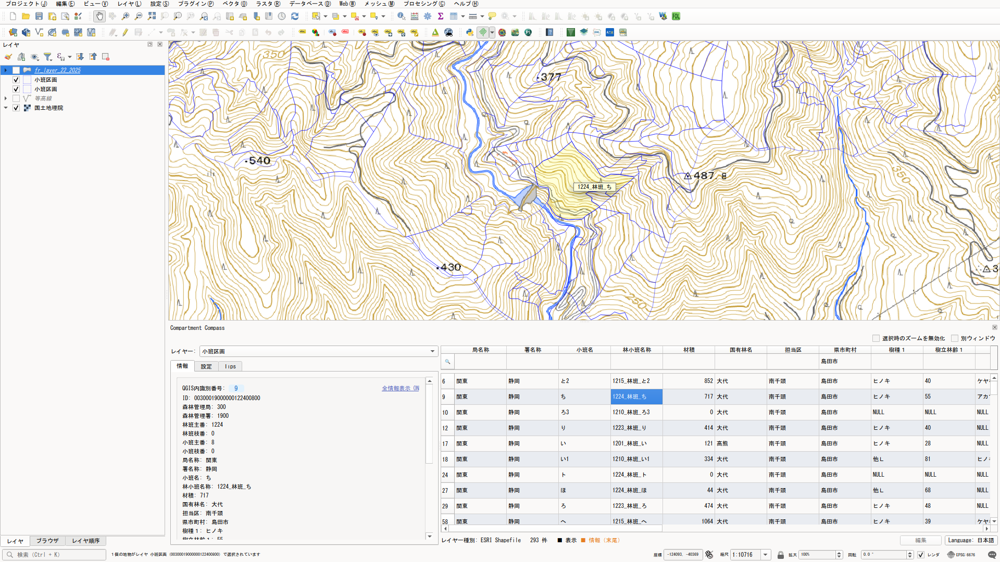

# Compartment Compass

A QGIS plugin that lets you filter, search, and — for GeoPackage layers — edit forest planning map data (森林計画図: national/private forest compartments, 小班・林班) in a spreadsheet-style table kept in sync with the map.




*Background map tiles: [国土地理院 (GSI, Geospatial Information Authority of Japan)](https://maps.gsi.go.jp/development/ichiran.html). Not bundled with the plugin — shown here only as the background layer already loaded in the project.*

[日本語はこちら](#日本語)

---

## English

Attribute editing works best when you can cross-check visual location and attribute information against each other — that idea starts from search that runs both ways between map and table. Rather than "select a feature on the map, then edit its attributes," Compartment Compass strengthens that two-way search: the attribute table is the starting point — filter down to the feature you need, confirm it, then edit it in place if necessary.

### Features

- **Spreadsheet-style filter row**: a per-column search row above the table — filter on any column, text or numeric
- **Table-map sync**: moving through the table highlights and zooms to the matching feature on the map; hovering a cell shows its value as a popup
- **Column modes**: set each column to shown / info (pinned at the end of the table, in orange) / hidden
- **Info tab**: shows your chosen fields (label: value) plus the QGIS-assigned ID (feature.id()) for individual identification
- **GeoPackage editing**: edit cells directly in the table, but only for GeoPackage-format layers
- Works with any vector layer already loaded in the project — not limited to forest data, and does not download or install data itself

### Filter syntax

```
Text columns:     substring match, case-insensitive
Numeric columns:  comma-separated comparisons
                   >, >=, <, <=, ==, !=
                   no operator = exact match

Examples
  >=100          100 or more
  <200           less than 200
  >=100,<200     100 or more, less than 200
  !=0            not equal to 0
  100            exactly 100
```

The same examples are also available (and copyable) in the panel's "Tips" tab.

### Column modes

| Mode | Description |
|------|-------------|
| Hidden | Not shown in the table |
| Display | Shown in the table's normal column order |
| Info | Shown read-only, always pinned after Display columns, in orange |

### GeoPackage editing

The edit-mode button at the bottom right of the table lets you edit attribute values directly, but only for GeoPackage-format layers — the button is disabled for Shapefiles and other formats. Edits go through a normal QGIS edit session (start → commit/rollback), writing directly to the layer. Leaving edit mode with unsaved changes shows a save/discard/cancel confirmation dialog.

Unlike gpkg_editor, there is no "plan" management or non-destructive editing (keeping edits as a diff without touching the source data) — if you need to compare multiple editing scenarios side by side, gpkg_editor is the better fit.

The Info tab's "QGIS internal ID" is the QGIS-assigned feature.id() — useful for pointing at a specific row, but note this is an internal, session-local number, not a persistent business key like a GPKG fid.

### Known Limitations

- Attribute editing works only on GeoPackage layers. Shapefiles etc. are view/search only.
- No "plan" management or non-destructive editing like gpkg_editor — edits write directly to the layer through a normal QGIS edit session.
- No feature add/delete — only editing existing features' attribute values.
- No data download/installation feature. Load the data into QGIS yourself first.

### Requirements

- QGIS 4.0 or later

### Installation

**From ZIP**

1. Download `compartment_compass_x_y_z.zip` from [Releases](../../releases).
2. In QGIS, open **Plugins → Manage and Install Plugins**.
3. Choose **Install from ZIP** in the left menu.
4. Select the downloaded ZIP and click **Install Plugin**.

**Manual installation**

Extract the ZIP and place the `compartment_compass` folder here, then restart QGIS:

| OS | Plugin folder |
|----|-------------------|
| Windows | `C:\Users\<username>\AppData\Roaming\QGIS\QGIS4\profiles\default\python\plugins\` |
| macOS | `~/Library/Application Support/QGIS/QGIS4/profiles/default/python/plugins/` |
| Linux | `~/.local/share/QGIS/QGIS4/profiles/default/python/plugins/` |

### Launching

After installing, launch it from the Vector toolbar icon (or **Plugins → Compartment Compass**). Toggle between docked and separate-window display using the "Separate window" checkbox at the top right of the panel.

### Support

If this plugin is helpful for your work, you can support the development here:
https://paypal.me/rawslnc

### License

This plugin is distributed under the GNU General Public License v2 or later.
See [LICENSE](LICENSE) for details.

### Author

Copyright (C) 2026 Hideharu Masai

### Disclaimer

This plugin was created to improve workflow efficiency. The author is not responsible for any damage resulting from its use. Back up your source data before using the editing feature.

---

## 日本語

属性編集は視覚的な位置情報と属性情報を相互に確認出来ることが重要です。このアイデアは相互の検索が起点になります。本プラグインは「地図上で地物を選択してから、その属性を書き換える」ではなく相互検索を強化しました——属性テーブルを主役にして、そこから目的の地物を絞り込み・確認し、必要ならその場で編集する、というテーブル視点の設計です。

### 主な機能

- **スプレッドシート風の絞り込み行**: テーブル上部の検索行で、任意の列（テキスト・数値）を対象に絞り込める
- **テーブルと地図の連動**: テーブル上を移動するたびに、対応する地物が地図上でハイライト・ズームされる。セルにカーソルを合わせるとその値をポップアップ表示
- **列の表示モード**: 列ごとに「表示／情報（末尾に橙色で固定表示）／非表示」を設定できる
- **Info タブ**: 任意に選んだフィールド（label: value形式）に加え、個体識別用にQGISが割り振るID（feature.id()）を表示
- **GeoPackage編集**: GeoPackage形式のレイヤーに限り、テーブルのセルを直接編集できる
- プロジェクトに読み込み済みの任意のベクタレイヤーに使える（森林データ限定ではない）。データの自動ダウンロード・設置は行わない

### 絞り込み構文

```
テキスト列: 部分一致（大文字小文字区別なし）
数値列:    カンマ区切りの比較式
           >, >=, <, <=, ==, !=
           演算子省略は完全一致

入力例
  >=100          100以上
  <200           200未満
  >=100,<200     100以上200未満
  !=0            0以外
  100            100と完全一致
```

同様の例は、パネル内「Tips」タブでも確認・コピーできます。

### 列の表示モード

| モード | 内容 |
|------|-------------|
| Hidden（非表示） | テーブルに表示しない |
| Display（表示） | テーブルの通常の列順で表示 |
| Info（情報） | 読み取り専用、常にDisplay列の後ろに橙色で固定表示 |

### GeoPackage編集

テーブル右下の編集モードボタンで属性値をその場で編集できますが、GeoPackage形式のレイヤーに限ります——Shapefile等では無効化されます。編集は通常のQGIS編集セッション（開始→コミット/ロールバック）による直接書き込みです。編集モードを終了する際、未保存の変更があれば保存・破棄・キャンセルを選ぶ確認ダイアログが表示されます。

gpkg_editorと異なり、「計画（プラン）管理」や「非破壊編集（元データを変更せず差分だけ保持）」の仕組みは持ちません。複数の編集案を比較しながら検討したい場合は、gpkg_editorの利用を検討してください。

Info タブの「QGIS internal ID」はQGISが割り振るfeature.id()です。特定の行を指し示すのに便利ですが、GPKGのfidのような永続的な業務キーではなく、あくまでQGIS内部・セッション限りの番号である点に注意してください。

### 既知の制限事項

- 属性編集はGeoPackageレイヤーのみです。Shapefile等は表示・検索のみで編集はできません。
- gpkg_editorのような「計画（プラン）管理」「非破壊編集」の仕組みは持ちません。編集は通常のQGIS編集セッションによる直接書き込みです。
- フィーチャーの追加・削除には対応していません（既存フィーチャーの属性値編集のみ）。
- データの自動ダウンロード・設置機能はありません。QGISへの読み込みは事前に済ませてください。

### 動作環境

- QGIS 4.0 以上

### インストール

**ZIPからインストール**

1. [Releases](../../releases) から `compartment_compass_x_y_z.zip` をダウンロードします。
2. QGISを起動し、メニューの **プラグイン → プラグインの管理とインストール** を開きます。
3. 左メニューの **ZIPからインストール** を選択します。
4. ダウンロードしたZIPファイルを指定し、**プラグインをインストール** をクリックします。

**手動インストール**

ZIPを展開し、`compartment_compass` フォルダを以下のディレクトリへ配置してQGISを再起動します。

| OS | プラグインフォルダ |
|----|-------------------|
| Windows | `C:\Users\<ユーザー名>\AppData\Roaming\QGIS\QGIS4\profiles\default\python\plugins\` |
| macOS | `~/Library/Application Support/QGIS/QGIS4/profiles/default/python/plugins/` |
| Linux | `~/.local/share/QGIS/QGIS4/profiles/default/python/plugins/` |

### 起動方法

インストール後、ベクタツールバー（またはメニュー **プラグイン → Compartment Compass**）のアイコンから起動します。ドック格納と別ウィンドウ表示を、パネル右上の「Separate window」チェックボックスで切り替えられます。

### サポートのお願い

このプラグインが役に立ったら、開発の支援をお願いします。
https://paypal.me/rawslnc

### ライセンス

本プラグインは GNU General Public License v2.0 以降のもとで配布しています。
詳細は [LICENSE](LICENSE) をご覧ください。

### 作者

Copyright (C) 2026 Hideharu Masai

### 免責事項

本プラグインは業務効率化を目的として作成されたものです。利用に伴い生じたいかなる損害についても、作者は責任を負いません。編集機能を使用する際は、事前に元データのバックアップを取ることを推奨します。
